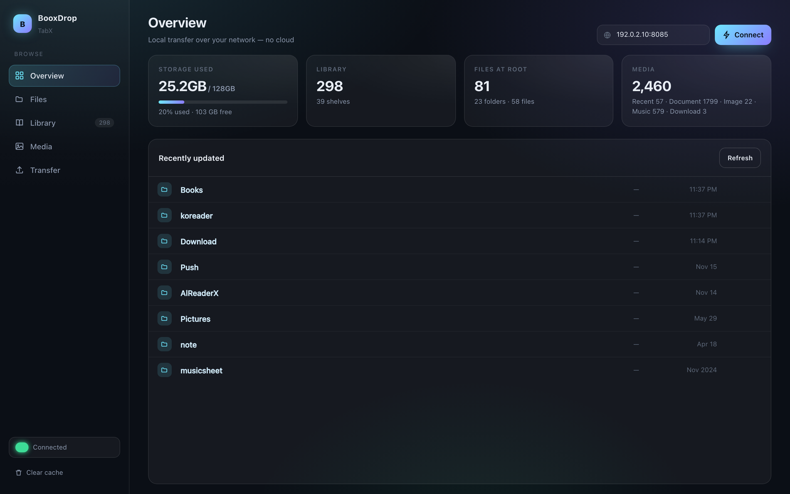
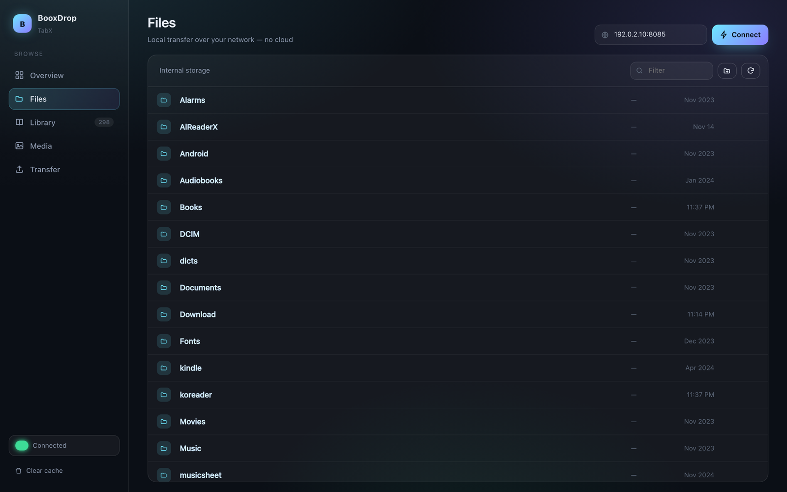
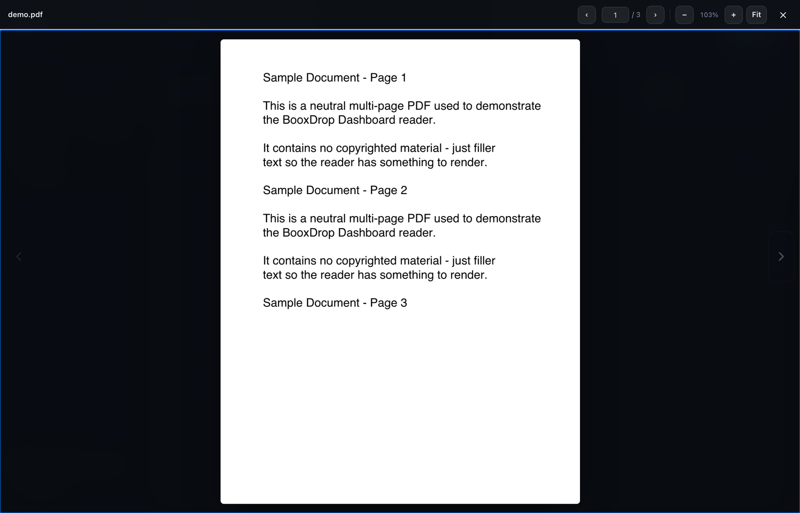

# BooxDrop Dashboard

A standalone desktop web dashboard for Onyx Boox e-readers. It talks directly to
the device's own local HTTP API — no cloud, no account, no app to install on the
tablet. Manage files, browse your library, read books, and transfer documents
over your local network.



> **Tested on exactly one device: Onyx Boox Tab X, Android 11, EasyTransfer
> v1.33.**
>
> The API this talks to is **undocumented** and was reverse-engineered from that
> firmware. Other Boox models and firmware versions may expose different
> endpoints, argument shapes, or port numbers, and **none have been verified**.
> If you try it on another model and it breaks, that is expected — please open
> an issue with your model and firmware details.

---

## Features

- **Overview** — storage used/free, library size, root file counts, media totals, recently updated files
- **Files** — breadcrumb navigation, live filtering, size/date columns, download, delete, create folder
- **Library** — shelf chips with book counts, real cover thumbnails, reading progress, format badges
- **Media** — category chips (Recent / Documents / Images / Music / Video / Downloads) with thumbnails
- **Transfer** — drag-and-drop or file picker, per-file progress, uploads to the current folder
- **Reader** — read PDF and EPUB in-app, with RTL/LTR awareness

### Screenshots

| Library | Files |
| --- | --- |
|  |  |

| PDF reader | EPUB reader |
| --- | --- |
|  |  |

---

## Quick start

### macOS app (recommended)

A native Swift wrapper with an embedded WebKit view. No browser, no Python, no
build step at runtime.

```bash
./build-app.sh      # compiles and installs to /Applications
open -a BooxDrop
```

Requires Xcode command-line tools (`swiftc`). The bundle is ad-hoc signed, which
is fine for local use.

### Any platform (plain web)

Serve the `dashboard/` folder and open it in a browser:

```bash
cd dashboard
python3 -m http.server 8899
```

Then open <http://127.0.0.1:8899/> and enter the address of your device
(shown in the **BOOX Drop** app on the tablet), e.g. `192.0.2.10:8085`.

The device must be on the same network with BooxDrop running. Use `http://`,
**not** `https://` — the device server is plain HTTP only.

---

## Reading direction (RTL/LTR)

Navigation adapts per document, because in Hebrew/Arabic books the "next" page is
to the **left** of the current one.

Direction is detected in this order:

| Source | Applies to |
| --- | --- |
| EPUB 3 `spine page-progression-direction` | EPUB (authoritative) |
| package `<dc:language>` → chapter `lang` | EPUB |
| Unicode script-ratio test on real text | EPUB + PDF |
| First 3 pages text-sampled | PDF (PDFs have no direction metadata) |

In **RTL** books:

- The **left** edge button advances; the right edge goes back
- `←` goes forward and `→` goes back
- `Space`, `PageUp`/`PageDown`, `Home`/`End` are **not** mirrored — they are not
  spatial, so flipping them would feel wrong

The reader **chrome stays LTR in every document**. Only the document body follows
the book's direction. This is deliberate: setting `dir="rtl"` on the whole
overlay mirrors the close button, the title, and the toolbar, and makes the
`1 / 164` counter reorder into `/ 164`. PDF pages render to a canvas and are
pixel-identical either way.

### Keyboard

| Key | PDF | EPUB |
| --- | --- | --- |
| `→` / `←` | next / previous page¹ | next / previous chapter¹ |
| `Space` `PageDown` `↓` | next page | next chapter |
| `PageUp` `↑` | previous page | previous chapter |
| `Home` / `End` | first / last page | first / last chapter |
| `+` / `−` | zoom in / out | font size up / down |
| `F` | fit whole page | — |
| `W` | fit width | — |
| `T` | — | cycle theme |
| `Esc` | close | close |

¹ Reversed in RTL documents.

PDF opens **fit-to-page** and re-fits when the window resizes. The *Fit* button
restores that after you zoom.

---

## Supported formats

| Format | Reader | Notes |
| --- | --- | --- |
| `.pdf` | ✅ pdf.js | page nav, zoom, fit, HiDPI |
| `.epub` | ✅ custom JSZip pipeline | spine order, inlined CSS, images as data URLs, themes |
| `.azw3` `.mobi` | ❌ | proprietary Kindle container — convert to EPUB |
| `.djvu` | ❌ | needs its own codec — convert to PDF |
| `.fb2` `.cbz` `.cbr` | ❌ | not implemented |

Unsupported formats show an explanation and are still downloadable.

**Converting with Calibre:**

```bash
ebook-convert input.azw3 output.epub --output-profile tablet
```

> **Note:** the device serves files with `Accept-Ranges: none`, so there is no
> HTTP range support. Every reader downloads the **entire file** before
> rendering. Fine for books; a 500 MB scanned PDF will be slow.

---

## Where files go, and why books go missing

The device's library index **only covers two folders**:

```
/storage/emulated/0/Books     ← 162 indexed books (measured)
/storage/emulated/0/Push      ← 136 indexed books
```

Anything saved elsewhere — most often `/storage/emulated/0` itself, where a
transfer naturally lands — is **on the device but invisible to the Library**,
because NeoReader never indexed it. There is no public rescan endpoint.

Two features deal with this:

**1. Uploads default to `Books/`**, not the root. The destination in the Transfer
view is an **editable field** with a **Pick…** button that opens a real folder
browser, so you can send files anywhere without them being stranded.

**2. Library → "Browse folder…"** scans any folder (recursively, 3 levels) for
book files and shows them in the same grid, with format badges and working
reader support. This is how you reach books the library index doesn't know
about.

Covers for these un-indexed books are generated client-side: EPUBs have their
`cover-image` / `<meta name="cover">` extracted from the package, and PDFs get
their first page rendered and cached. (The device's own
`/api/storage/thumbnail` endpoint is unreliable for arbitrary paths — it often
returns the whole file or a 500.)

## Caching

The device API is slow: `/api/library/tree` takes **~1.6 s**, and the library
view needs 36 per-shelf calls on top — about **6.5 s** cold.

Responses are cached in memory + `localStorage` (`boox.cache.v1:` prefix), keyed
by full URL so a different device never mixes data. It is
**stale-while-revalidate**: serve cached data instantly and paint, then refetch in
the background.

Measured on a 298-book library: **cold 6.3 s → warm 141 ms (~45×)**, shelf
switching ~5 ms.

The cache is invalidated automatically on upload, delete, and folder creation,
and there is a **Clear cache** button in the sidebar. If `localStorage` hits its
quota, the oldest 40% of entries are evicted and the write retried once —
caching is an optimisation, so a failure degrades to a normal fetch.

---

## API notes

Reverse-engineered from `EasyTransfer.apk` v1.33. **Undocumented — expect
breakage across firmware versions.**

| Endpoint | Method | Notes |
| --- | --- | --- |
| `/api/ping` | GET | returns the literal text `ok` |
| `/api/device` | GET | `nickname`, `model`, `storageTotal`, `storageUsed` |
| `/api/storage?args={"dir":"<path>"}` | GET | **`dir`** is the key; a plain string is ignored |
| `/api/storage/file?args=<path>` | GET | downloads a file |
| `/api/storage/thumbnail?args=<path>` | GET | thumbnails **and book covers** |
| `/api/storage/upload` | POST | multipart; destination is a **form field** |
| `/api/storage/directory` | POST | JSON `{parent, name}` — note `parent`, not `dir` |
| `/api/storage/delete?args=<path>` | DELETE | `args` must be a **plain path**, not JSON |
| `/api/media` | GET | categories with counts |
| `/api/media/list?args={"mediaType":...}` | GET | `page`/`size` work |
| `/api/library/tree` | GET | shelves, each with `library.idString` and `bookCount` |
| `/api/library?args={...}` | GET | see the pagination trap below |

### Gotchas that cost real debugging time

**1. Directory listings are server-cached.** After a delete or upload, a plain
re-list still shows old contents. Pass `"refresh":true` in `args`.

**2. Upload destination is a form field, not a query param.** This looks right
and silently does the wrong thing:

```js
// WRONG — file lands in /storage/emulated/0/Books/ regardless of `dir`
POST /api/storage/upload?args={"dir":"/storage/emulated/0/Download"}
```

```js
// CORRECT
const fd = new FormData();
fd.append('dir', '/storage/emulated/0/Download');
fd.append('file', file, file.name);
POST /api/storage/upload
```

The server defaults to `Books/` when `dir` is missing, so a wrong upload *looks*
successful — always check the returned `message` path.

**3. Delete needs `args` as a plain path.** Sending JSON returns `successful:true`
and deletes nothing:

```bash
# WRONG — reports success, deletes nothing
DELETE /api/storage/delete?args={"path":"/storage/emulated/0/Download/x.txt"}
# CORRECT
DELETE /api/storage/delete?args=/storage/emulated/0/Download/x.txt
```

**4. Create folder uses `parent`, not `dir`:**

```js
POST /api/storage/directory   {"parent":"/storage/emulated/0/Download","name":"New"}
```

**5. The biggest one — `/api/library` `limit` is a SHARED budget.** The same
`limit` covers both the shelves and the books, and with `libraryUniqueId:null`
the book list is greedily reverse-sorted:

- `limit:24` → 0 books, 5–24 shelves
- `limit:50` → 11 books
- `limit:200` → 19 books, and never more

A 298-book library can only ever surface ~19 via the aggregate query.
**Pagination does not work.** The fix used here: fetch every shelf individually
with `libraryUniqueId = <shelf.library.idString>` and `limit:300`, then merge and
dedupe.

**6. Shelf filtering is `libraryUniqueId`.** `libraryId`, `shelfId`, `id`,
`parentId` and `libraryIds` are all silently ignored.

**7. Book covers come from the device thumbnail cache.** Use `item.coverPath`
with `/api/storage/thumbnail?args=<coverPath>`. Fall back to a generated title
card when empty.

**8. The WebSocket (`ws://<host>:8085/`) accepts connections but does not answer
ad-hoc frames** on this firmware, so HTTP is the reliable path.

---

## Project layout

```
dashboard/
  index.html          markup and views
  app.js              API client, cache, view logic
  reader.js           PDF + EPUB readers
  styles.css          theme and layout
  vendor/             pdf.js + JSZip (vendored, works offline)
native/
  main.swift          macOS WebKit shell + embedded loopback server
build-app.sh          builds and installs BooxDrop.app
docs/screenshots/     README images
```

## Credits

- [pdf.js](https://mozilla.github.io/pdf.js/) — PDF rendering (Apache-2.0)
- [JSZip](https://stuk.github.io/jszip/) — EPUB container parsing (MIT)

Both are vendored in `dashboard/vendor/` so the app works with no network access.

## License

[MIT](LICENSE)
